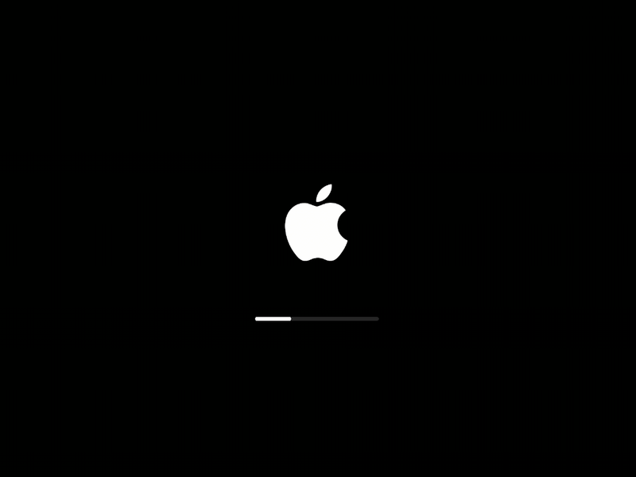
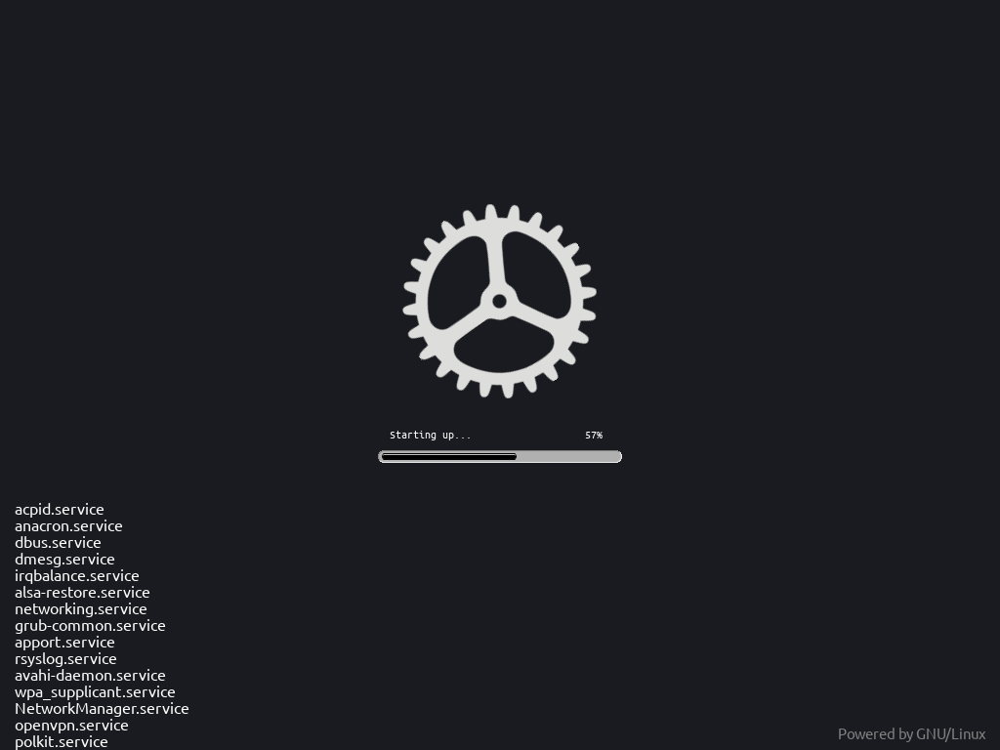
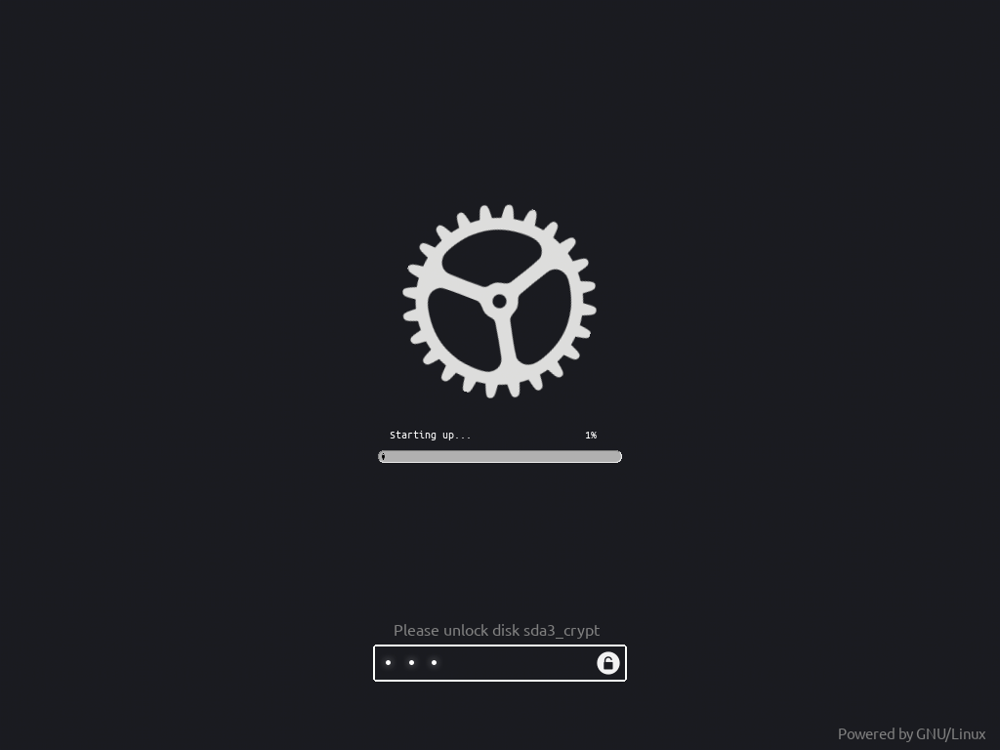

<div align="center">

# 🌌 Plymouth Themes Collection

**Plymouth boot splash themes for Linux. Make your startup look as good as your desktop.**


[Previews](#-previews) · [Install](#-installation) · [Try it](#-try-it-without-rebooting) · [Credits](#-credits)

</div>

---

## 🎨 Themes

| Theme | Vibe | Description |
|:---:|:---:|---|
| **`osx`** | 🍎 minimal | macOS-style Apple logo with a progress bar (fan-made) |
| **`connect`** | ✨ animated | "Connecting" dots animation (from adi1090x) |
| **`log`** | ⚙️ techy | Rotating gear + scrolling boot log (based on DUKE93's COGWHEEL theme) |

---

## 🖼️ Previews

<div align="center">

### 🍎 osx



### ✨ connect


### ⚙️ log

 

</div>

---

## 🚀 Installation

### ⚡ One-liner

No clone needed. This downloads the themes and installs them.

```bash
# interactive menu
curl -fsSL https://raw.githubusercontent.com/fhudint/plymouth-thems/main/install.sh | sudo bash

# install and activate a specific theme (osx, connect, log)
curl -fsSL https://raw.githubusercontent.com/fhudint/plymouth-thems/main/install.sh | sudo bash -s -- osx
```

> [!WARNING]
> Piping a script into `sudo bash` runs it as root. Read [install.sh](install.sh) first if you want to know exactly what it does.

### 📦 From a clone

```bash
git clone https://github.com/fhudint/plymouth-thems.git
cd plymouth-thems

sudo ./install.sh              # interactive menu
sudo ./install.sh osx          # install and activate a theme (osx, connect, log)
sudo ./install.sh --all        # install all themes without activating
sudo ./install.sh --remove osx # uninstall a theme
./install.sh --list            # list available themes
```

<details>
<summary><b>🔧 Manual installation</b></summary>

<br>

```bash
sudo cp -r osx /usr/share/plymouth/themes/      # or: connect, log
sudo plymouth-set-default-theme -R osx           # Fedora/Arch: -R rebuilds the initramfs
# Debian/Ubuntu: sudo update-alternatives --install ... then sudo update-initramfs -u
```

</details>

> [!NOTE]
> Plymouth also needs `splash` on the kernel command line (e.g. `quiet splash`).

---

## 👀 Try it without rebooting

```bash
sudo ./preview.sh osx 5   # show an installed theme for 5 seconds, then restore the previous one
```

---

## 🙏 Credits

- **`connect`** comes from [adi1090x/plymouth-themes](https://github.com/adi1090x/plymouth-themes) by Aditya Shakya ([@adi1090x](https://github.com/adi1090x)). This repo is not a fork; only the `connect` pack was taken from the 80+ packs in that repository. The original license is in [connect/LICENSE](connect/LICENSE).
- **`log`** is based on COGWHEEL-A-SPINNER-LOG-PGR-2-GRAY by DUKE93.

## ⚖️ Disclaimer

The `osx` theme is a fan-made tribute and is not affiliated with, endorsed by, or sponsored by Apple Inc. Apple and the Apple logo are trademarks of Apple Inc., used here for illustrative purposes only. Remove the theme if you do not have the right to use these marks in your context.

## 📄 License

The `log` theme is derived from DUKE93's work and is licensed under GNU GPL v3 or later. The `connect` theme keeps its original license, included in its folder.

---

<div align="center">

Made with ☕ by [fhudint](https://github.com/fhudint)

</div>
